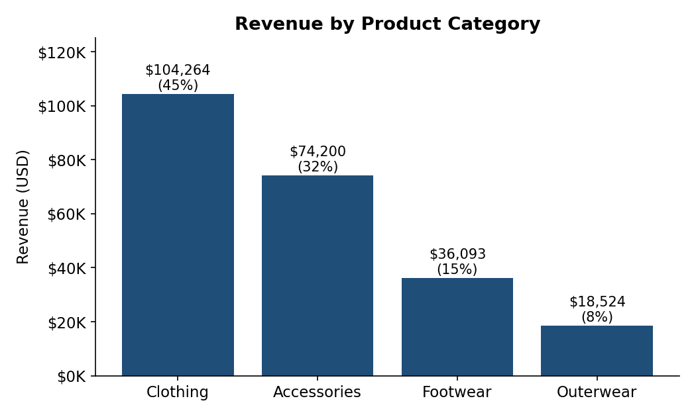
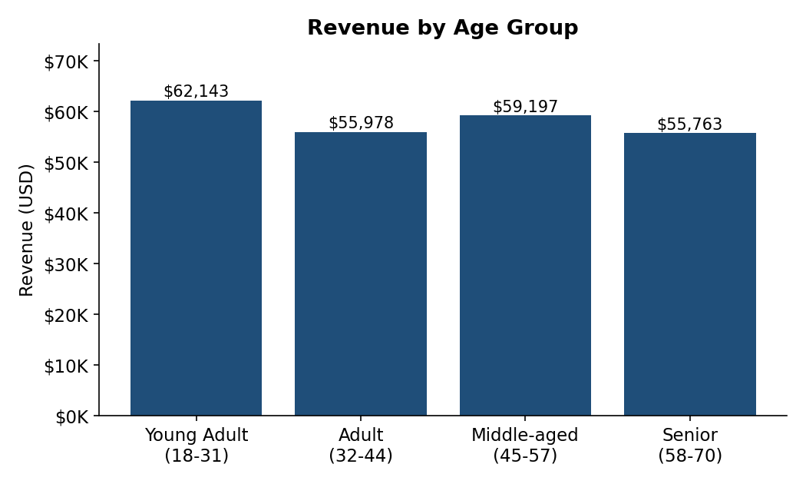

# 🛍️ Customer Shopping Behavior Analysis

## 📌 Project Overview

This project focuses on analyzing customer shopping behavior to identify purchasing patterns, understand customer preferences, and explore revenue trends across different product categories and age groups.

The project uses Python for data cleaning and exploratory data analysis (EDA), MySQL for database management and SQL analysis, and Power BI for data visualization.

## 🎯 Project Objectives

* Understand customer shopping patterns and purchasing behavior.
* Analyze revenue generated by different product categories.
* Identify revenue trends across customer age groups.
* Clean and preprocess raw customer shopping data.
* Perform business analysis using SQL queries.
* Generate meaningful insights to support data-driven decision-making.

## 🛠️ Tools & Technologies

| Tool             | Purpose                          |
| ---------------- | -------------------------------- |
| Python           | Data cleaning and analysis       |
| Pandas           | Data manipulation                |
| Jupyter Notebook | Python development               |
| MySQL            | Database management and querying |
| SQL              | Data analysis                    |
| Power BI         | Data visualization               |
| Microsoft Excel  | Data handling                    |

## 📂 Project Structure

```text
customer-shopping-behavior-analysis/
│
├── 01_data_cleaning_and_mysql_load.ipynb
├── analysis_queries.sql
├── Customer_Shopping_Behavior_Analysis_Report.pdf
├── requirements.txt
├── LICENSE
├── README.md
│
├── revenue_by_category.png
└── revenue_by_age_group.png
```

## 🔄 Project Workflow

### 1. Data Cleaning using Python

* Imported the customer shopping dataset.
* Explored the dataset using Pandas.
* Checked for missing and duplicate values.
* Cleaned and prepared data for further analysis.
* Performed data preprocessing.

### 2. Database Management using MySQL

* Loaded the cleaned dataset into MySQL.
* Created and managed database tables.
* Used SQL queries to retrieve and analyze customer data.

### 3. SQL Analysis

Performed SQL analysis to explore:

* Revenue by product category.
* Average purchase amount by category.
* Customer shopping patterns.
* Revenue by customer age group.
* Other business-related questions.

### 4. Data Visualization

Created visualizations to understand:

* Revenue distribution across product categories.
* Revenue contribution by customer age groups.

## 📊 Project Visualizations

### Revenue by Category



### Revenue by Age Group



## 💡 Key Business Analysis Areas

* Which product categories generate higher revenue?
* What is the average purchase amount across categories?
* Which age groups contribute to customer revenue?
* What patterns can be identified in customer purchasing behavior?

## 📁 Project Files Description

| File Name                                      | Description                                    |
| ---------------------------------------------- | ---------------------------------------------- |
| 01_data_cleaning_and_mysql_load.ipynb          | Python data cleaning and MySQL loading process |
| analysis_queries.sql                           | SQL queries for business analysis              |
| Customer_Shopping_Behavior_Analysis_Report.pdf | Detailed project documentation                 |
| requirements.txt                               | Required Python libraries                      |
| revenue_by_category.png                        | Category-wise revenue visualization            |
| revenue_by_age_group.png                       | Age-group revenue visualization                |

## 📚 Skills Demonstrated

* Data Cleaning
* Exploratory Data Analysis (EDA)
* Python Programming
* Pandas
* MySQL
* SQL Query Writing
* Data Visualization
* Business Analysis
* Data Interpretation

## 🏁 Conclusion

This project provided practical experience in working with customer shopping data using Python and MySQL. Through data cleaning, SQL analysis, and visualization, the project explores customer purchasing behavior and revenue trends.

It demonstrates how data analytics techniques can help transform raw data into meaningful business insights.

## 👨‍💻 Author

**Onkar Gawad**

Bachelor of Science in Information Technology (B.Sc. IT)

Mumbai University

**GitHub:** [onkar gawad58-cmd](https://github.com/onkar gawad58-cmd)
